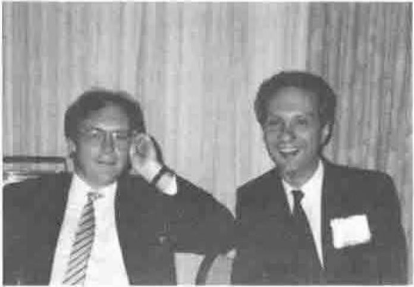
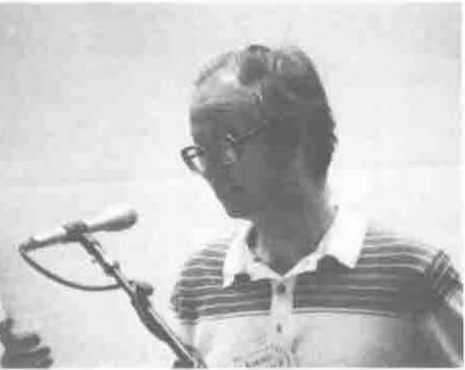
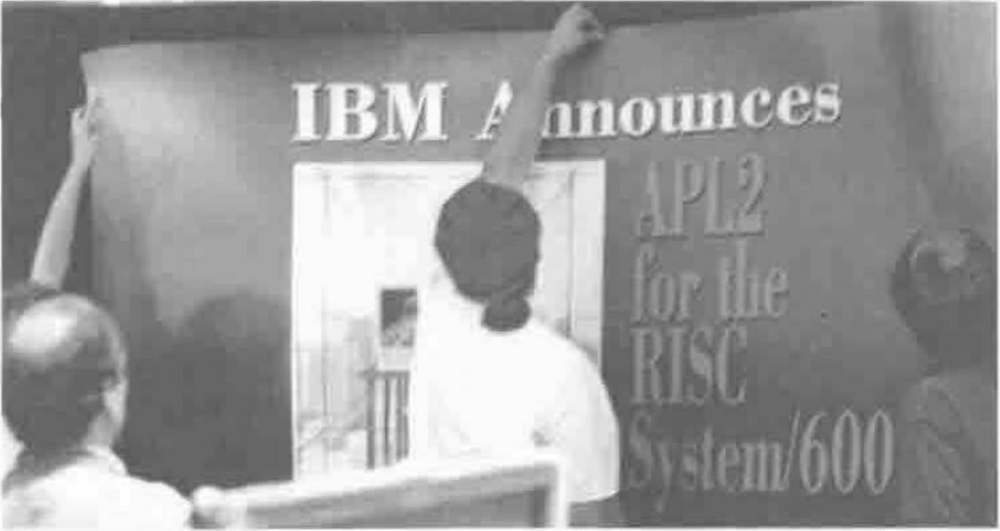

## Invited Speaker: Phil Smith. Reflections on Magic, Dreams, and Programming

*reported by Jonathan Barman*
{ .byline }

Phil Smith came onto the platform with electronic sensors attached to his forehead. These were hooked up to a PC display so we could see his brain waves in action during the presentation. The first 10 minutes were pre-recorded, with both voice and PC display. I could not make out if he was controlling the recording by changing thought patterns, or if he was just well rehearsed. Later on he gave a demonstration of choosing an item from a menu by thought control, but again I could not make out if it was real. I feel sure it was not a hoax.

I thoroughly enjoyed the display of capturing data from simple devices, and then using APL to display the results. One of the devices was based on the infra red measuring instrument used for focusing a Polaroid camera, and could measure distances very fast and accurately. The PC captured the stream of distance measurements, and then APL functions were used to display the data. Phil walked towards the device and then displayed the speed and acceleration of every footstep. He put it on the floor and flexed a bouncy spring over it and then showed the resulting damped sine wave. Another device was a freely rotating arm with an accurate measure of the angle traversed. Demonstrating that the frequency of a pendulum depends on length and not on amplitude could be carried out in minutes. When I was at school the same thing took days of preparation and computation, and at the time seemed quite tedious. There must be some very lucky students who benefit from Phil's work.

## MicroAPL Vendor Forum

*reported by Adrian Smith*
{ .byline }

This was probably the most interesting vendor session, as MicroAPL had taken a good deal of trouble to keep their product under wraps until the conference. It was however slightly marred by the fact that the conference Barco stoutly refused to accept the signal from the RS/6000.

*David Eastwood and Richard Nabavi*

MicroAPL's strategy is similar to IBM's in that they have one source code copy in a relatively low level language (68000 Assembler / Series-1 assembler) which can be transliterated into other assemblers, as long as these have a broadly similar structure. With the SPARC and RISC instruction sets, the mapping is typically 1->2 or 3, but the structural fit is quite good, so the end product runs quite fast. The other respect in which MicroAPL resemble IBM is in their total commitment to the APL2 standard. This leaves the user in the fortunate position of being able to choose a totally compatible APL on any of the PC, Mac, Unix or mainframe platforms; whatever your views on APL2, this has to be good news.

The user-interface is fully Motif/CUA compliant, with all the standard cut&paste actions, an easy printer interface and the complete APL manual available as on-line help. The interface to Motif was designed from the outset to be easy **not** to use! The problem with managing 1034 C-calls from your APL application is that you have to turn yourself into a C programmer to do it. MicroAPL have tried to make a reasonable subset of the facilities available to APL with a simple set of functions (e.g. `ALERT` to put up a warning box) which are designed for APLers, not C-folk. The Motif resource mechanisms are used to fill in the details, e.g. if you want a dark blue button you set that up in Motif, and APL will automatically use it.

The next steps are towards SPARC (MIPS and HP machines), more optimisations, a clean implementation of `⎕NA` and an OpenLook version. MicroAPL intend to offer a free runtime policy with a packager available 'at a modest price'. They are beta-testing through September, and are aiming to launch on September 26th.

## Panel: Modes of Thinking and Their Implications for APL

*reported by Jonathan Barman*
{ .byline }

Hal Macklin has a special interest in the way the brain processes APL. Research with people who have suffered brain damaged has shown that Japanese Kanji characters take a different route through the brain compared with normal script. Mathematical symbols seem to bypass language areas of the brain, and so does music.

Devon McCormick stressed the difference between parallel and serial modes of thought. APL needs parallel thinking which seems to be more complex, but APL enables one to cope with complexity. Someone coding a string search routine serially usually fails to notice the overlapping match problem, but coding in APL in parallel highlights this problem.

Phil Smith has had personal experience of the way APL changed his way of thinking, and has analysed the nature of this change.

Stan Kelly-Bootle felt that APL was not the only area where special thought processes must occur. He was impressed by the fact that the topologist who finally solved the problem of turning a sphere inside out happened to be blind.

Hal Macklin wondered why APL provoked such strong reactions from people. Could it be that an extraordinary number of the APL creators and enthusiasts are left handed?

Stan Kelly-Bootle thought that APL is not dying, but is just a minority cult.

## Psycho-Biographical Analysis with APL, by A V Kondrashev & A A Kronik

*reported by Sylvia Camacho*
{ .byline }

The subject matter of this application of APL is intriguing: the investigation of differences in subjective assessment of life experiences and expectations of longevity between populations assumed psychologically balanced and those requiring therapy. We were told that the prototype for this model was produced in one day and then developed in spare time. The model allows data to be captured, transferred to a database, subjected to statistical analysis and the output to be presented graphically.

One finding of the research is that expectation of a long life is a good indicator of psychological well-being. A recent analysis of differences between groups of men and women in their attitude to perestroika showed, on this assumption, that soviet men are considerably more optimistic than soviet women.

## Supply-Chain Management at Rowntree: Critical Success Factors for APL, by Adrian Smith

*reported by Anthony Camacho*
{ .byline }

The presentation was a first-rate guide on how to survive with APL, disguised as a workmanlike summary of the advantages and disadvantages of APL in the Rowntree-Mackintosh environment.

I extracted the following precepts: don't use any vendors' special features; they tie you to the vendor and make your APL non-portable. Don't use any vendor-supplied workspaces. Only use code you fully understand and can maintain. Write cover functions for machine-dependent features such as graphics to simplify porting. Prefer PC work to mainframe; the PC user interface is far better. Don't use enhancements. Nested arrays and defined operators greatly increase the amount staff have to learn before they become effective. Buy faster PCs to make such simple code fast enough for your needs.

*Adrian Smith*

Collect a well designed and tested, centrally maintained set of utilities. This will improve robustness, reduce training time for new staff, reinforce coding standards by example, and greatly reduce development time on new systems (in Rowntree 85% to 90% of a system is utilities). Bear in mind that the scope of packages will grow. APL's advantage is as a notation for expressing hard sums effectively; use APL in circumstances where this advantage is decisive and don't fight the battles you might lose.

*reported by Ray Cannon*
{ .byline }

Adrian Smith's talk on Supply-Chain Management was the most amusing, and all done without mirrors or any other visual aid.

## Invited Speaker: Therese Myers. Simplifying the View of a Complicated Technology

*reported by John Searle*
{ .byline }

Therese Myers is President of Quarterdeck Office Systems of Santa Monica, California, the software company responsible for DesqView, which is a "multi-tasking" organiser for DOS machines. Her talk was an aggressive marketing pitch for her company and its forthcoming DesqView/X product, which will allow PCs to simulate X-terminals in a Token Ring or Ethernet network. This will enable existing investment in DOS machines to be carried forward into a Unix workstation environment.

The basic theme of her talk was that Quarterdeck is better than Microsoft, and whatever we do they copy about two years later. Now that Microsoft is the top of the heap, I suppose they are the prime target for criticism, but I felt there was too much emphasis on the put-down in her talk.

In technical terms, Quarterdeck have ported X11 Release 4 to DOS, and the user interface will be able to look like either Motif or OpenLook. Networking will be available through TCP/IP, Decnet or PC/NFZ.

The only reference to APL in the talk was that an APL Application Programming Interface is available "if there is an interest in it". (For "interest", read "profit".) It has been written by one of her APL-enthusiast colleagues. Unfortunately, her view of the limited APL market will probably prevent it from emerging.

## The Exhibition Area

*notes by Adrian Smith*
{ .byline }

Suddenly, all APLs are starting to look the same! Even Digital were there, running under DECWindows, to merge with the crowd of RS/6000s. STSC were oddly placed in the exact centre of the room, and seemed to be ignored by the majority of delegates who followed a natural path around the four walls, and thus found themselves back at the exit without ever visiting the little island in the middle!

*Getting the IBM Stand Ready*

Dyadic were actually showing their APL under Windows-3, but I was advised in no uncertain terms that it was more than my life was worth to even think about touching the mouse. They were right ... even under the careful guidance of John Scholes it still crashed with glorious unpredictability at the worst possible moments. IBM and MicroAPL were there too, but I couldn't get their stuff to break ... how boring!
