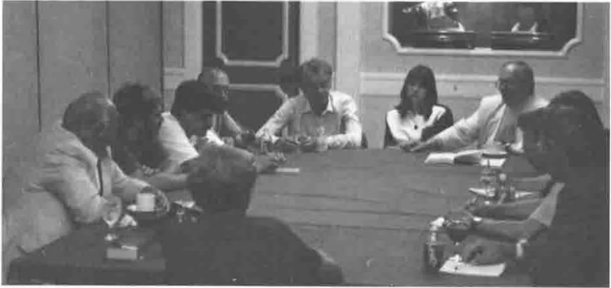
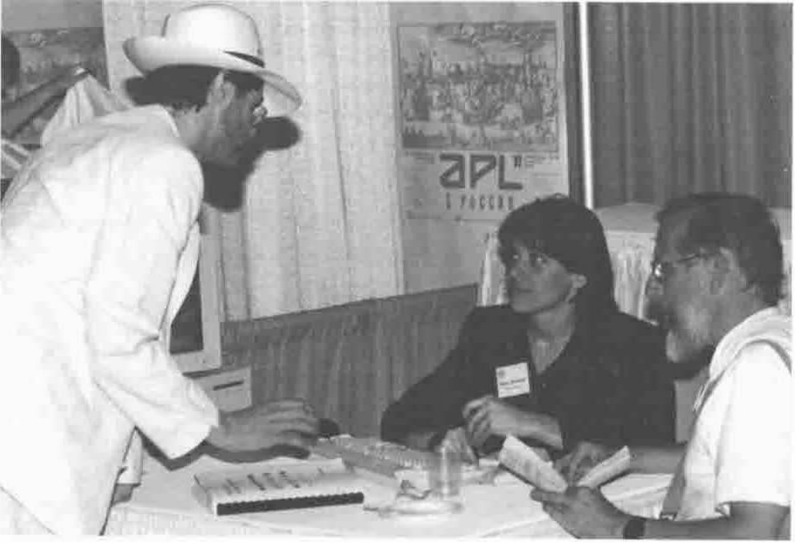

The APL Community has been gathering in international conferences since 1973. We have believed these conferences are the showplace of worldwide APL activities. Quite recently we have however become aware that we have been missing a major area of APL development and APL applications because the Soviet Union APL community has not been represented in our international meetings.

This long time ignorance and negligence was caused by political and language barriers and by missing contact between western and Soviet Union APL people. In the broadest sense we could say that we did not have a common language, we did not know how to communicate.

APL 90 in Copenhagen was a big door-opening event where the western and eastern APL communities met. It was found that the Soviet Union is one of the APL countries. The USSR Academy of Sciences, the Ministry of the Nuclear Industry, and other state and public organisations sponsor APL development in the Soviet Union.

## The first GLOBAL Conference on APL

APL 91 in Leningrad is meant to be the first truly global APL conference where western and eastern APL communities, hitherto virtually unknown to each other, will meet and create fruitful new contacts. We would like to build a world of mutual understanding, but we remember the story about builders of the Tower of Babel, who failed due to the lack of a common language. We want to show in practice how APL is the **Language in Common** for people with different cultural and language backgrounds. To overcome still existing language barriers all conference presentations and speeches will be translated from English to Russian and vice versa and there will be bilingual helpers around to facilitate personal communication. The proceedings will be published in English.

The data processing field in the Soviet Union is in a strong expansive phase. The Soviet APL community is well prepared for the expanding market. The western APL community can help Soviet APL people to fight for a better position in this dynamic environment. The technology and the experience from the West combined with the "new blood" from the East can give a strong impulse to the success of APL world wide.

The APL 92 Program Committee expects a broad spectrum of papers dealing with various aspects of the language, APL implementations, supporting software, and applications. We also want to focus on APL in the mixed environment where multiple national languages, multiple currencies, and different standards are used. The integration of the world economies requires new solutions, and APL can show its strength there. We would also like to get papers concerning teaching technology and the role of APL in it.

## Conference Overview

The APL 92 Conference will take place 6 - 10 July 1991 in Leningrad, northwestern Soviet Union. The Conference site is the Architecture and Building Training Centre of the State Committee of the Nuclear Energy Usage. Its own hotel can accommodate 270 participants at a reasonable cost and city international hotels will be available for those who wish to live near the attractions. The Centre is situated about 3 miles from the city centre near a metro station with fast service all around the city. In addition, a convenient taxi and special bus shuttle services will be provided at a fixed price. Two restaurants in the Centre will be in the service of the participants for lunches and dinners. A coffee shop for refreshments will be open all day.

Leningrad is the second largest city in the USSR. It was founded in 1703 by Peter the Great as the new capital of the Russian Empire. Leningrad is situated on the delta islands of the river Neva. There are more than one hundred rivers and canals with more than 300 bridges across them. Some of the bridges are drawbridges which are raised every night. Leningrad has a vast number of historical and architectural monuments, churches, palaces and museums, minutely preserved, all open to the public. The famous Leningrad "white nights" in the high summer make it possible to enjoy its beauty twice around the clock.

**Activities:** The main conference will run from 6 - 10 July, including: submitted papers presented in parallel tracks; sessions of posters addressing short or informal topics; opening and closing sessions featuring prominent speakers in fields of interest to APL users; vendor exhibits and vendor forum. Rooms will be available for special sessions organised by user groups, committees etc.

**Tutorials:** On Sunday, 5 July, tutorials will be given in two parallel tracks, one to give an introduction to APL language, the second on general computer science topics. Both are intended to focal students and other interested individuals, given mainly in Russian. The tutorial sessions are open to anybody even without registration.

**Social events and cultural programme:** A variety of social events will provide opportunities to meet other attendees informally. Leningrad is rich in cultural events like concerts, ballet and circus performances, theatres etc. The conference office will help with reservations. Special tours for accompanying persons will be offered during the conference and side trips will be organised after the conference. One of the planned post conference tours is an International Conference on Computers in Education on board a comfortable ship. It will cruise along the northern rivers of Russia and visit the centres of the Russian wooden architecture, the islands Kigi and Valaam. The participants of APL 92 are exempt from the registration of this second conference.

### Start Planning for Participation!

- Please, return the enclosed interest card for priority mailings.
- Come to Leningrad to meet experts, share information, experience the Russian charm and exotic surroundings, make friends.
- Write a paper. Use the interest card to indicate your topic. Draft papers are due by 1 November 1991. Paper drafts and abstracts should be sent to the contact nearest the sender. Authors will be notified of acceptance by 1 February 1992 and will receive an author kit. Final camera-ready papers are due by 1 April 1992.
- Show a poster. Use the interest card to indicate your topic. Send us an abstract of the program by 1 March 1991.
- Exhibit your products and services. Rent a booth, schedule a forum, sponsor a social event. Please contact the organisers or use the interest card to get information as early as possible.
- Teach a tutorial of chair a session. Indicate your speciality using the interest card.
- Join ACM SIGAPL and receive a discount for the conference.

## Travel and Communications

Leningrad was chosen as conference site partly because it is near Finland and its capital Helsinki, served by all major international airlines. Leningrad is 40 minutes from Helsinki by airplane, six hours by train or by bus. In order to ensure reliable and speedy mail and telecommunications services, a conference sub-office is operating in Helsinki.

Official carrier of the APL 92 Conference is Finnair. Finnair is an expert in travelling to Soviet Union from the United States, Europe and Japan, and will provide a traveller kit with telephone numbers, schedules and other useful information to make your planning and travelling easy and economic.

*The first meeting of the APL92 Program Committee*

*Paul Chapman & Lee Dickey booking for APL92 with Olga Kondrashev*
