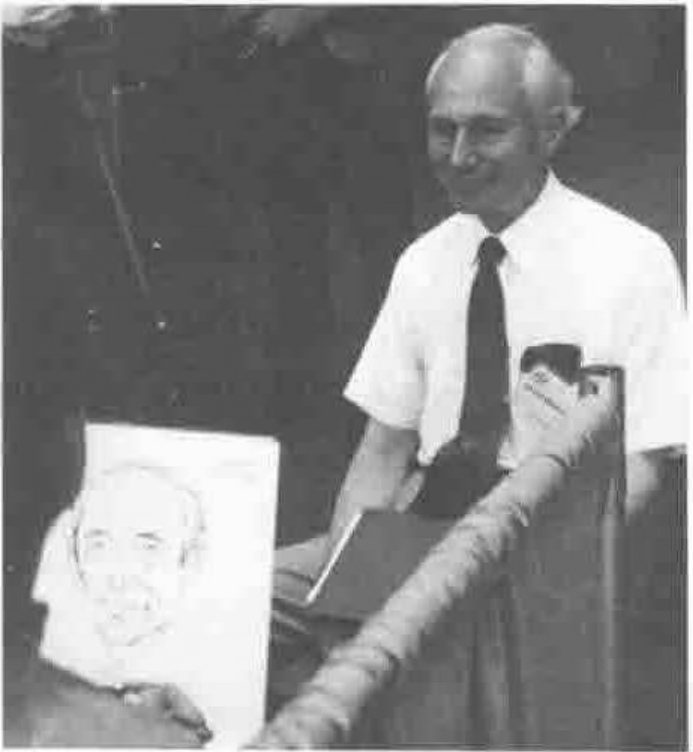

## Mastering J, by Donald McIntyre

*reported by Anthony Camacho*
{ .byline }

APL, which nearly got called Iverson's Better Math, encounters resistance because it requires people to learn new symbols. Now, ironically, J is encountering resistance among APLers because it does not use the symbols they know. Donald admitted he himself suffered distress making the change.

*Donald McIntyre with Peter McDonnall's Drawing*

It is, in any case, the ideas that matter and Donald McIntyre has no doubt that the ideas in J are an improvement on APL. J is the best as well as the latest version of Iverson's notation.

Donald is still Mastering J and feels that his difficulties may be encountered by other non-theoreticians. He needed more examples than are given in the terse Dictionary of J and he sets out to provide some in this paper.

Through the good offices of Vin Grannell this session was videorecorded. With luck, if the recording was successful, Donald's presentation may reach a wider audience.

One of Donald's specialities is illuminating asides. I learned that we owe the rank operator to Arthur Whitney and that a conjunction in J, is like a dyadic operator in APL. I assumed that a conjunction and two verbs produce a verb. Then one of his examples produced a verb from a conjunction and nouns! I didn't note the phrase; I hope it is on the tape.

## Tacit Definition, by Roger Hui, Kenneth Iverson and Eugene McDonnell

*reported by Anthony Camacho*
{ .byline }

I felt it fitting that Gene McDonnell presented this paper because, in The Four Cube Problem (APL Press 1981) he presented to the world the best example I've seen of how to write programs without variables. It convinced me that there was something superior about direct definition.

Within the direct definition, however, one did refer to arguments as `⍺` and `⍵`. Gene pointed out that there is no ambiguity about the meaning of the expression `+/` even though there is no argument. Further expressions may be added which specify what to do with the result returned by `+/`. In J, such collections of expressions can be assigned to a name. Some of the features of J make this extremely terse and elegant style of programming much easier to use than it was in APL; such things as fork, hook, with, atop and commute.

Explicit definition in J uses `x.` and `y.` where APL used `⍺` and `⍵`. In J one can define average explicitly, thus: `average=.  (+/y.)%#y.` or, using tacit definition, thus: `average=.  +/%#`, which uses a *fork* (q.v.).

The later versions of J contain a primitive (`:11`) which converts an expression from explicit to tacit form. This is an extension of the parser. A tacit definition does not need to be parsed but can be executed at once so tacit definitions are, in effect, compiled and are executed significantly faster. Gene said that the parse tree also indicates what can be done in parallel and what has to be done serially. This augurs well for a J implementation on parallel processors.

A questioner recalled that Al Rose, in 1966 or '67, proposed the high minus as a suffix should be the symbol for commute with the mnemonic 'the dashing commuter operator'.

## Nuclear Power Plant Diagnostics in APL, by Alexander Skomorokhov

*reported by Sylvia Camacho*
{ .byline }

This paper, in the proceedings, is a sober professional piece of work. The paper as presented was a pleasure to attend and a triumph over the odds. Alexander began by thanking his audience for attending despite the rival attraction of a paper by Iverson. He followed this by a cartoon show that produced appreciative laughs for every overhead he showed. This made his apology for his English pronunciation 'you should consider it as noise on the line' quite superfluous. Mention of a model of a nuclear power plant was accompanied by a picture of Madonna and Child followed by a reference to Chernobyl and Three Mile Island and a picture of the Old Man with the Scythe.

The timescale for the application is interesting. Their first introduction to APL was via Gilman and Rose in 1979 and they realised their own interpreter in 1985. The incentive to use APL to try for early warning of incipient problems within nuclear reactors was explained by a cartoon of a Greenpeace Protest.

The first version of the system was in 1989 and, as a result of a meeting with Per Gjerlov, Erkki Juvonen and Jim Brown, this was converted to APL2 with a consequent reduction of two thirds of the code. In the way of Management world-wide this was met by a question from the boss 'Why do we have to pay more for less code?'

The final 'thank you for listening' was displayed on the screen including a seven replicate of 'very' much and a good round of applause for a good Show Man.

Questions revealed an interesting concern among the audience that APL should be used in such security-critical circumstances. The response was that APL is currently an investigative tool and prototyper and would probably be converted into other languages for use in production.

## Invited Speaker: William L Scherlis, DARPA Software Activities and Opportunities for APL

*reported by Anthony Camacho*
{ .byline }

Dr William Scherlis of the Defence Advanced Projects Research Agency (DARPA) told us that the agency's mission was to develop advanced technologies for the Department of Defence: it has 160 staff and a budget of a billion dollars a year.

There are two kinds of activity, military-specific (with a known military aim), and multiple-use which covers computer systems and scientific research.

On the computer systems side there are four main efforts:

1. High performance computer systems - teraflops is the goal.
2. Advanced software technology - the grand challenges here are:
    - major problems such as the numerical simulation of thunderclouds;
    - the component-based approach to managing large software systems (a million lines of code);
    - automatic conversion from serial to parallel.
3. The national research and education network - the aim is gigabit speed networks. Arpanet is part of this effort.
4. Basic research and human resources.

Software has to cater for a long life cycle of twenty years or more, much higher reliability than for commercial work and must be organised so that requirements that change during development can still be satisfied.

The component-based approach to managing the development of large systems must allow each component to be developed by an appropriate method; not all necessarily in the same language or even the same computing environment.

Dr Scherlis ended his survey by listing the opportunities he saw for APL.

- as one of the systems for development
- as a fast prototyper with a wide spectrum
- as a rich source of ideas for array-specific designs

and he wondered whether it was possible to scale up the interactive experimental APL approach so that large systems could be developed faster.

DARPA is a technology investor - not a policy-making organisation. Its prototyping project is unlikely to lead to any language being specified as the prototyping language for defence.

*reported by Jonathan Barman*
{ .byline }

It was interesting to hear that APL can fit into the mega software projects that DARPA initiates. The main requirement is that APL should be able to interface smoothly with other languages and systems, for example, an interface between APL and Oracle.

The primary opportunity for APL is in the rapid prototyping of systems. Some concern was expressed from the audience that one of the software projects is to identify a common prototyping language for DOD. Apparently there won't be an 'official' language.

## Plenary Session. APL Standards Report

*reported by Anthony Camacho*
{ .byline }

Professor L J Dickey brought us up to date on the latest meeting of the Standards Committee. About ten people attended, from USA, Canada, France and Belgium. IBM, DEC and STSC were represented: others were users or consultants. The meeting agreed to add enlist, pick, depth, match and each (on floating nested array systems) and are moving in the direction of adopting strand notation. They may even make `1 2 3[2]` an error to allow them to adopt strands. [Your reporter expected a chorus of boos at this point: there was not one.] Anything added will be as addenda to the standard. The group hopes to speed its work by greater use of electronic mail.

ISO group 11 is interested in language-independent data types and arithmetic.

There are two groups standardising character sets. Unicode is supported by about a dozen of the major players and aims at a single character encoding. ISO 10646 is a competing effort. The APL standards group is trying to persuade both groups to include all the APL characters. If they succeed it will simplify moving functions between platforms.

## The User Command Processor, by Jim Weigang

*reported by Ray Cannon*
{ .byline }

Jim Weigang's paper on STSC's user command processor was, to me, the least interesting talk that I went to, but that may be because over the last year, I have implemented and now support over 150 commands using the User Command Processor.

The paper was a blatant advertisement for a useful but badly implemented product. Fortunately it is possible to improve the implementation, and Dave Ziemann and Peter Cyriax have done exactly this.

## Pure Functions in APL and J, by Edward Cherlin

*reported by Anthony Camacho*
{ .byline }

Ed Cherlin made a few concessions to people who did not know something about combinatorial logic, but not enough for me; all my logic was learned before the seminal book Combinatory Logic was published. Concealed among the logic was the proposition that all expressions in J can be written without explicit reference to variable names. In some sense, if this is true it makes J functionally complete.

Ed proceeded to prove this proposition to his satisfaction, but I did not follow the proof.

The advantage offered for functional completeness did not seem very great. If all expressions can be written as abstracts (i.e. without variables) then this simplifies the construction of expressions under program control and the application of operators (adverbs) to expressions. I had the feeling that I had missed something: in my bones I feel that the elegance of abstracts (the same things, I am sure, as tacit definitions) must bring other extra advantages. But my bones are not exactly a reliable oracle.

## Gerunds and Representations, by Bob Bernecky and Roger Hui

*reported by Anthony Camacho*
{ .byline }

Someone (Arthur Whitney?), at APL 89, when asked to give the three most desirable improvements to APL answered (1) speed, (2) speed and (3) speed. Bob Bernecky and Roger Hui are interested in compiling for speed. "The real reason for disliking GOTO is that it makes compiling difficult." Bob wants to be able to compile for parallel processors. Most languages are Single Instruction, Single Data (SISD). APL is Single Instruction, Multiple Data (SIMD). Bob wants to find ways to compile APL so that it becomes Multiple Instruction, Multiple Data (MIMD).

His slide on motivation read:

- No syntax change
- Generalised adverbs
- Improved reliability
- Easier compilation
- Partial support for MIMD
- Parallel control structures: CASE, IF ....., DO.....
- Makes verbs first class objects (I think this means that verbs can be the subjects and results of computations)

A gerund is a form derived from a verb which can be used as a noun: for example the word programming in the sentence programming is an art. This paper is a proposal that an operation done to a verb in J should convert it to an atom. This atomic form can be handled like a noun. Another operation could convert the noun back to verb and as a result various interesting control structures can be created.

The verbal nouns thus formed can be put into arrays and some of the benefits that various people have suggested might arise from arrays of functions can be obtained. A design goal is to make compilation possible without limiting the expressive power of J.

## APL Technology of Computer Simulation, by A Boozin and I Popselov

*reported by Sylvia Camacho*
{ .byline }

Both authors of this paper are academic mathematicians and their use of APL is just where one might expect it to be: in modelling linear differential equations and stochastic Markovian processes.

Questions put showed that they first used APL 15 years ago on terminals to what was described as 'a big old computer'. Currently they use APL\*PLUS/PC. They have set up an environment in which they can split the screen and display data graphically with some zoom facilities. This environment can be used in conjunction with raw APL while exploring the results of a model, or can be used in conjunction with data derived from APL or some other source.

In fact it is often used by Pascal programmers. Most recently they have been setting up economic models to try to come to terms with the consequences of decentralisation and privatisation. They use both Roman and Cyrillic alphabets.
