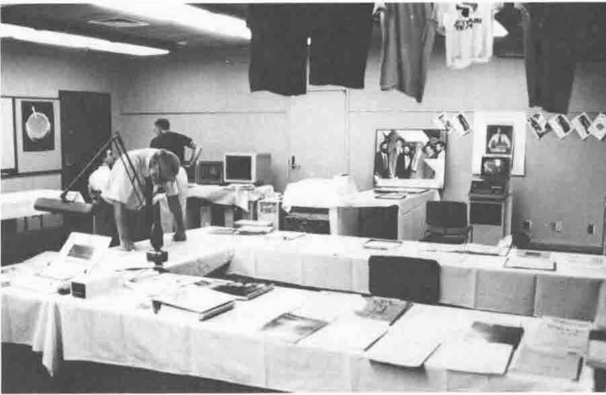
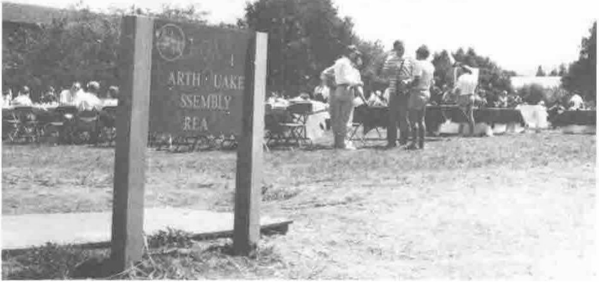

## A0 System - APL in Construction Planning, by Alexei Miroshnikov

*reported by Sylvia Camacho*
{ .byline }

The speaker's presentation was a summary of his paper. The paper shows the APL application to be very ambitious although the project has been under way for little more than a year. The impression given is that this system is more closely related to western expectations of commercial programming systems than those described by other soviet delegates. The overall approach to the work sounds very professional and your reviewer will not be alone, I am sure, in wishing it well. Any improvement in the facilities available to industry in the USSR is welcome and the construction industry must be a priority.

During the questions, attempts were made to discover how construction planning was done in the days of the centralised economy. Maybe most of the audience could not get over the language barrier but the answer appeared to be that there had been no significant computer involvement before perestroika.

*reported by Jonathan Barman*
{ .byline }

A0 is a system which calculates construction costs based on detailed requirements for materials and labour. The system is written in APL\*PLUS/PC, and took 3 developers 3 years to complete. The prototyping of the system was carried out with the customers.

APL made the development quicker, and the package came second in a competition up against packages written in other languages. However, there were disadvantages in using APL. Discipline in the programming of APL seems to be difficult, the facilities for interfacing with other languages is poor, and programmers found it difficult to debug packaged code.

## Automatic Synthesis of the Inverses of APL Functions, by Alvin Surkan

*reported by Ray Cannon*
{ .byline }

This was the most fascinating paper on the use of APL that I came across in the conference. In this paper Surkan describes how neural networks are trained to solve complex problems, these solutions are then analysed and the results written in APL. By writing the APL in a particular fashion (following some "special standards" such as only allowing "monadic" functions) the resulting code can be "inverted" by reversing the "polarity" of functions (for example, dividing by a factor rather than multiplying by the factor) and reversing the order of execution. The process is some what similar to how DNA produces an inverted copy of itself (messenger RNA). (See Douglas R. Hofstadter's book "Godel, Escher, Bach: an Eternal Golden Braid" on self replication.) Try doing that in C!

## Invited Speaker: Ted Nelson. Sealing Our Data

*reported by John Searle*
{ .byline }

Ted Nelson is Distinguished Fellow at Autodesk of Sausolito, California. He is the inventor of hypertext, and is the visionary behind the Xanadu hypermedia project. The project has the simple aim of completely revolutionising the way in which data is stored and organised in computer systems.

In this new scheme, files will be replaced by data "puddings", and Xanadu will provide the structure for interconnecting items of data. According to Nelson, cohesive ideas emerge from good organisation of data - this is the manner in which the human brain works - and this is how we should design intelligent systems. Nelson has a "20/20 Vision", believing that by the year 2020 computer systems will operate in this way. Public systems will use a Universal Electronic Publishing system, in which the author of a contribution will pay to lodge it, but will obtain royalties every time it is used. Intelligent use of "pointers" will minimise the need to move and duplicate items of data.

Nelson's thesis is very much at the global thinking level, and he is not too concerned about the impracticalities and nitty-gritty details of his scheme at this stage. His talk was full of glib remarks and quotable quotes. "The moving storm of computer progress leaves many puddles, in which teem interesting life forms."

Nelson also believes that we are gathering and storing data at a faster rate than we can process and organise it. NASA has so much information from space and orbital probes, that it has appointed a Data Archaeologist to manage it.

Nelson urged us to recognise when we are faced with Paradigm Confrontation. We only understand the boundaries of our belief systems when they are challenged by new thoughts, which cause our hackles to rise. His challenge to us is to accept the limitations of our data architecture, and to be prepared to change it.

## The APL91 Museum

*reported by Dave Ziemann*
{ .byline }

APL91 was the first International APL Conference, as far as I am aware, to include an APL museum. A room was set aside to display artefacts from the long history of our favourite language, now a quarter of a century old. In one corner, an IBM 5110 was eagerly (yet slowly) playing Tic-Tac-Toe, announcing its progress via a speech synthesiser connected to it. The 5110 was one of the first APL personal computers, and is a direct ancestor of the rather more famous IBM PC line.

*George Mendonsa's Museum*

I was strangely attracted by the perverse beauty of an APL punch card - a regular Hollerith card where every punchable position was overprinted by an APL symbol. This is how the first APL interpreter, developed here at Stanford by Larry Breed and Phil Abrams on an IBM 7090, was programmed. In the words of the "APL Blossom Time" song, vinyl copies of which were also on display:

> Well a FORTRAN batch interpreter's a mighty awesome thing 
> But while it hums a pretty tune it doesn't really sing. 
> The thing that we all had to have to make our lives sublime 
> Was an interactive program that would let us share the time. 
> Oh... They got Roger Moore and they got Dick Lathwell, 
> And they got Gene McDonnell with his carets and his sticks, 
> And you should have heard the uproar in the Hudson river valley 
> When the saved the first CLEANSPACE in 1966.

With brilliant foresight, Larry Breed saved that very early APL printout. It is a slightly faded piece of lineprinter paper which includes a dialogue between Larry and the machine operator, followed by the successful saving of the first ever clear workspace, called CLEANSPACE. The system save date was 27 November 1966.

The museum contained a variety of APL books and delegate gifts from previous conferences. Ken Iverson's original book, "A Programming Language" was there. A copy of the first edition of "APL - An Interactive Approach" by Gilman and Rose was represented. That famous edition of the 1964 IBM Systems Journal, which contains a paper that uses APL to describe the architecture of a new line of machines - the IBM 360 series - was also there. The "Iverson Notation" inside that journal looked very different from the APL we know today.

A number of attempts to keep track of the genealogy of APL have been made, and SIGAPL's effort is included in the museum - a database of who learned APL from whom.

Original 2741 golf balls and the paper tape that Al Rose used to feed into his machine to demonstrate APL when the mainframe went down were popular items. One of the best ideas was a little book where conference delegates could enter details of any historical APL objects which they possessed. There were two boxes to tick, one if you wanted to keep the item yourself, and another if you were willing to donate it to the newly formed APL Museum.

If any Vector readers have memorabilia which they feel the APL Museum should know about, please write to the Editor who will forward the information. If you have something you would like to donate to the museum, even better. One rich area of exploration could be old APL language manuals, particularly those from unusual APL systems.

I'll finish with the latest verse of the "APL Blossom Time" song, created during the conference, and reflecting events of recent years in the APL world:

> Now Bob Brown said we need a faster APL, 
> So Arthur Whitney wrote one, but his bosses would't sell. 
> And some planners said interpreters no longer were in style, 
> So they sat down at their hardware, and they started to compile. 
> Well ... we got Roy Sykes and we got Clark Wiedman, 
> and they ran it jus as fast as all the hardware would allow. 
> We don't have compilers on our personal computers, 
> But our PCs all run faster than the mainframes anyhow!!

## Quotable Quotes

"That's either a typo or a thinko, I'm not sure which." *Bob Bernecky*

"The Dashing Commuter. (In 1966 or '67 Al Rose suggested the high minus suffix as the symbol for 'commute', and suggested this mnemonic.)" *E E McDonnell*

"We have one function called `X` ... that's probably a bad name to use." *John Jensen*

"I don't get the negative responses [with J] that I used to get with APL." *Bob Bernecky*

"IBM specified the minimum response to a timesharing response was to be 5 seconds - faster would frighten the user!" *Larry Breed*

"Ken Iverson loves arguments; I think I got hired by arguing with him." *Larry Breed*

"I am flattered that at my age you think I could have the imagination to come up with a completely new language, unrelated to APL." *Ken Iverson* commenting on the J dialect issue.

"Always ask the customers what they want, and then don't pay any attention to it ... that's how we designed APL." *Adin Falkoff*

"I was exposed to APL but didn't catch it." *Andy Kinslow quoted by Gene McDonnell*

"Oh my goodness - an Iverson Ball!" *Gene McDonnell* on seeing the very first APL Selectric typeball

"Consult the written materials ... they're suspect too, but at least they stand still while you compare them." *Ken Iverson*

"The sad part - success brings paralysis. You soon get to the point where you can't get anything interesting changed. Even changing companies doesn't help much!" *Ken Iverson*

"Time wounds all heels." *Peter de Vries quoted by Ken Iverson*

"I am not of your church, ... but I greatly respect it, and I am here in the interest of ecumenism." *Ted Nelson*

"This is a palette of fabulous power, which I wish every kid had access to." *Ted Nelson*

"For 27 years I was considered a worthless maniac ... now I am considered a worthy maniac." *Ted Nelson*

"WYSIWYG - what you see on the **screen** is what you get on the **paper**! You are going to use that magnificent machine as a *paper simulator*." *Ted Nelson*

"In the traditional system, the user is just a subroutine of the application." *Alexander Skomorokhov*

"A culling needs to take place, and time will do it." *Ken Iverson*

"There is nothing complex about complex numbers, unless you don't understand them." *Donald McIntyre*

"My arithmetic is very poor, but then I'm a geologist ... 12 and 24 are near enough the same thing if you are talking about the age of the earth." *Donald McIntyre*

"If you don't like the news, go out and make some of your own." *Tibor Horvath*

*The Final Picnic*
