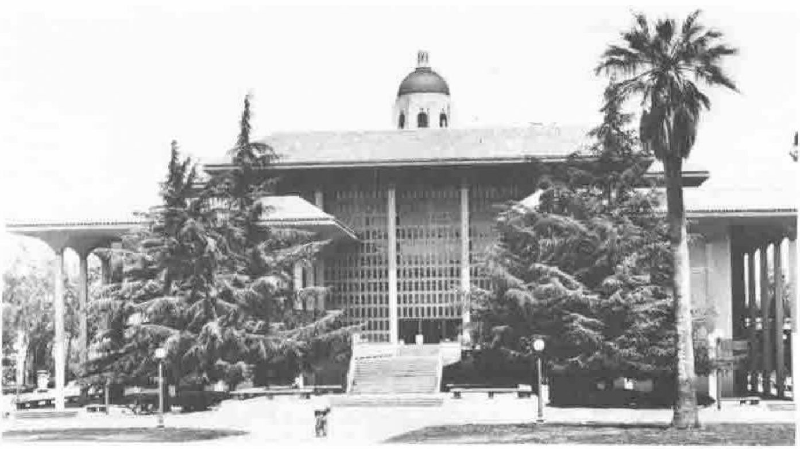

*by Adrian Smith*
{ .byline }

One enormous advantage of spending the six weeks following APL91 globetrotting is that everyone else has already written up their notes when you get back! This (a) saves you a lot of work and (b) gives you the chance to reflect a little on how things went. It bothers me a little that almost without exception my colleagues have reported the entire event in the kind of glowing terms that the Nestlé News uses to record company progress towards ultimate supremacy in the chocolate world. Yes, of course as a conference it was a success: it was professionally run (I wonder at what expense if the breakeven was as high as 400?); the Stanford campus was all you could expect of it; the Exploratorium was brilliant; the picnic was great; .... but

- did you learn any new APL?
- where were all the papers proposing interesting and controversial language extensions?
- apart from J, were there any new ideas at all?
- was it a Conference or a Reunion?

To repeat that rather apt Ted Nelson quote:

> "The moving storm of computer progress leaves many interesting puddles, in which teem interesting life."

As one of the 400 or so puddle-dwellers gathered at Stanford, let me offer some final thoughts on desert life, and the survival strategies it engenders:

1. Everyone swims round and round in ever-decreasing circles, talking in loud voices about nothing in particular. Any attempt to turn the conversation towards dangerous topics ("I wonder if it will rain today?") is quickly lost in the general hubbub. This is probably the least successful strategy.
2. The Australian frog approach is to gulp as much water as you can (becoming almost spherical in the process), burrow into the mud at the bottom, and wait. This works quite well as long as it eventually rains again, but it does rather commit you to a long slow death otherwise.
3. You could try walking on your fins, gulping air at a frantic rate, and setting off in search of another puddle. Of course you will very likely fail, but there is just a chance that you will evolve from a crude amphibian into a primitive reptile into the most successful species the world has yet known (well, the dinosaurs did run the show for 150 million years, so they must have got something right).

The J debate was a classic example of the first strategy, the second is well illustrated by the Sharpies (who are already well buried in the mud) and the APL2 developers (who are settling gently to the bottom). Ken Iverson and Don McIntyre were among the few who were brave enough to get up on their fore-fins and hobble off across the desert in pursuit of Ted Nelson's retreating storm. I think we should all wish them luck.

*Stanford Library, with the Hoover Tower behind it*
