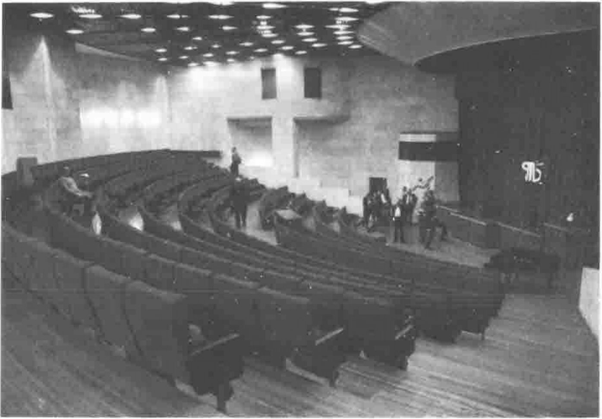

## Invited Speakers

**Igor Pospelov** - *Russia on the Way from Plan to Market: The Experience of Modelling.* Professor Pospelov is a well-known Russian mathematician who specialises in economic modelling. He works in the laboratory for mathematical modelling of economic systems in the Computing Center of the Russian Academy of Sciences. Prof. Pospelov has over ten years' experience using APL. His presentation deals with the modelling of different transformations of the economy, along with a discussion and interpretation of the results.

**Howard Peelle** - *Education and the Future of APL.* Dr. Peelle is an accomplished APL teacher, author, and educator. As Associate Editor of *APL Quote Quad,* he continues to make a contribution to this area. His presentation will cover a number of questions of great concern to every APL enthusiast. Potentially, the educational system can provide a well-head for new members of the APL community. Dr. Peelle is working together with a team to prepare other activities on the theme of APL and Education for APL92.

**Per Gjerlov** - *The Song of the Whale.* Since APL90 (Per was Program Chair) our closing Plenary speaker has been travelling the Atlantic Ocean with an oceanographic team, recording and analysing audio data from groups of whales. Per will explain some of his work in detail, and show us some marvellous images (of whales and data!) to bring APL92 to a rousing close.

The final program will include additional invited speakers on APL and its development and future in Russia.

## Tutorials

On the day before APL92 officially opens, a Tutorial day will be held in classrooms at the Education Center.

> *An introduction to APL* - by Ray Polivka, noted author and teacher of APL, and winner of the ACM/SIGAPL Iverson award. This tutorial is oriented towards those with little or no exposure to APL.
>
> *An APL tutorial for Russian Children* - is being organized in conjunction with the "APL in Education" theme.
>
> *Russian for APLers* - Proposed tutorial, to run on Sunday and during APL92. Those attending this tutorial will gain some understanding of simple Russian sufficient to ask and understand simple questions, small phrases, and words useful for polite greetings and common dialogue.

**Please note:** Scheduling for this tutorial is based on the interest level expressed by those registering. A check-box on the registration form can be used to show your interest, and a tutorial session may then be organized.

## Call for Posters

Poster sessions, and poster submissions, are traditional for conferences in many technical disciplines. Posters are relatively new to APL conferences, having been introduced first at APL89. The name "Poster" comes from the practice of submitting material in the form of a poster (or sign), which is displayed at the conference.

Posters are used to show novel ideas and reports of work in progress. A separate session will be devoted to poster presentation. Authors of posters can discuss the poster, and distribute related materials as conference participants circulate to discuss them.

If you would like to show a poster, please send a title and abstract by 1 June to the APL92 conference office. We can include it in the final program, and ensure that space will be available for your poster presentation.

## Vendor Exhibition

An area of the Center has been set aside for use by vendors for showing products and services of interest to the APL community. We also encourage exhibitions from any organization needing exposure to well-placed computing professionals within and beyond the Commonwealth of Independent States.

Vendor forums are offered for those who wish to present commercial products in detail. Some forums will not conflict with the APL92 technical program, and provide attendees with a good chance to meet APL vendors. If you attend APL92, we expect that vendor forums will provide another interesting facet of the conference. If you are a vendor, please contact one of the APL92 offices, as some exhibit facilities and vendor forum times are still available.

## Accepted Papers - APL92

Warren Julian, Australia - *Writing Macintosh Applications in APL.* Features of a student enrolment and record system for use on Macintosh computers are described, emphasising the development of the interfaces between the user and the APL file environment.

Ruby Lim, Australia - *Cannibals and Missionaries.* The old game of Cannibals and Missionaries is presented. The solution (sometimes surprising!) is derived, and is implemented using APL.68000.

Moishe Sniedovich and Suzanne Findlay, Australia - *Jogging With APL Along the Shortest Path.* The classical shortest path problem is examined and the modelling issues are illustrated by formulating APL code for a number of generalizations, including multi-objective problems.

Walter G. Spunde, Australia - *Challenging the Mathematics Curriculum.* Packages accompanying mathematical texts often try to make computing power serve as a simple non-disruptive adjunct to the current syllabus. The author asserts that instead it should serve to accomplish that which previously could not be done, rather than merely to expedite drudgery.

Andreas Geyer-Schultz and Thomas Kolarik, Austria - *Distributed Computing with APL.* APL is suggested as a prototyping and debugging tool for distributed applications in the growing UNIX market segment. Several programming constructs are implemented via shared variables in the distributed environment.

Jacob Mitlohner, Austria - *Porting APL Programs via Readable ASCII Transliteration.* A translation scheme for writing APL code to a plain text file is introduced, and a transfer system is developed which reads and writes objects to and from files.

Robert Bernecky and Gert Osterberg, Canada - *Compiler Tools in APL.* Compiler development tools in APL, including finite state machines and parsers, are shown to be of significant value in a number of common applications. Examples include a financial trading system and a UNIX tab expander.

Edward Y.H. Lin, Canada - *Multiple Choice Programming: An APL Approach.* This paper introduces a set of APL code for the optimisation of multiple choice programming using the special-ordered-set branch-and-bound procedure incorporating the partitioning strategy of the weighted mean method.

Norman Thomson, England - *APL2 Specification of Statistical Algorithms.* APL2 has striking affinities with the apparatus needed to specify statistical algorithms. Some rules and conventions for the basis of such a standard are proposed, and the appropriateness of APL2 is illustrated.

Gustav Tollet and Peter Harrison, Finland - *A Bezier Curve Builder.* A Bezier curve provides a cubic approximation to a curve between two points. Two additional points specify a tangent and a relative weight at each end point. The paper describes techniques used to smooth a broken line approximation. Applications (Font generation, Graphics) are covered and emphasised.

Jean-Jacques Girardot, France - *The CTalk Programming Language: A Strategic Evolution of APL.* CTalk, a new programming language quite different from APL, is presented. An attempt to combine the best features of APL and languages such as LISP and C, it looks "modern" according to the criteria of the mainstream of computer science.

Gerard A. Langlet, France - *Towards the Ultimate APL-TOE.* Can the laws of nature be reconstructed independently from research in theoretical physics (on elementary particles and matter in general)? Can the same process be applied to algorithms using APL?

W. Hahn, Germany - *Auxiliary Processor AP87.* An auxiliary processor, supporting extended precision (IEEE 754 standard) arithmetic for APL/PC is described. This tool provides a number of techniques for dealing with extended precision numbers in APL.

Cristoph Pospiech, Germany - *An APL2 Tool Box for Investigating Schwarz Methods.* An APL tool box is described which allows one to interactively investigate and compare algorithms for solving elliptic partial differential equations by Schwarz methods.

Tien Chi Chen, Hong Kong - *Globally Convergent Polynomial Iterative Zero Finding Using APL.* The paper describes a global iteration theory for polynomial zero-finding. A new formula, based on the target function and its first two derivatives, is demonstrated to have better convergence properties than two classical schemes.

Renato Capra, Italy - *3D Layout Manipulation Functions with a Glance to Optimization Problems.* APL syntax provides a very simple and expressive way to generate and manipulate 3D parametric objects. The paper describes a user-friendly interactive graphic system for 3D layout manipulation.

F.H.D. van Batenburg, Netherlands - *Sorting and Optimizing Star - A Case Study of Suffering and Surfacing.* After a brief description of an application in micro-biology, the paper reports on the migration of the system between workstation platforms.

Valery Kalinin and Boris A. Makeev, Russia - *APL as a Tool for Scientific Forecasting.* An expert system for forecasting development within fields of science is discussed. APL\*PLUS/PC is chosen as the implementation language and the rationale for the choice is presented.

Alexander Skomorokov, Russia - *Do Russian Children Like APL2?* Describes experiences teaching children about computer science using APL2. Both goals and methods are included, along with proposed extensions to use APL to teach many other subjects.

Alexey N. Skurihin, Russia - *Neural Networks in J.* The attempt to implement Artificial Neural Systems is described. The language J is used to facilitate a straightforward implementation.

Manuel Alfonseca, Spain - *Object-Oriented Graphics in APL2.* The paper describes a general and extensive graphic system in two or three dimensions, built in APL2 by means of the object-oriented programming paradigm. The system fully demonstrates the appropriateness of the language to develop real-life applications.

Martin Gfeller, Switzerland - *Walks into the APL Design Space.* APL is evolving. The choices for future work constitutes a "design space" for future development. This paper assists the reader in exploring the APL design space on one's own. References to books and articles about problems and solutions are given.

J. Philip Benkard, USA - *Introduction to Nested Arrays and Operators.* Continuing exploration of the implications of nested data structures, comparing and contrasting the importance of the rank operator.

James Brown and Erik Kane, USA - *APL2 Implementation of Cross System Shared Variables.* The requirement for inter-machine communication is discussed. It is met with APL2's cross-system shared variables. In particular, the mapping of APL2's cooperative peer-to-peer communication model onto a client server data transport mechanism is described.

Evan Jennings, USA - *An Object-Oriented APL2 Expert.* An expert system which can answer questions posed in English about APL2 is described. The programs are written in APL2 using object-oriented programming techniques. The knowledge is hierarchical and frame based.

Curtis A. Jones, USA - *Left to Its Own Devices, APL Plots on the Bus.* A PC with APL can be used as a device on the IEEE-488 General Purpose Interface Bus. An APL workspace which emulates an x-y plotter illustrates some uses.

Peter A.W. Lewis, USA - *A Full-Screen, Scrollable, APL2 Spreadsheet Input/Output Editor.* A spreadsheet editor based on IBM's APL2 language for 386 machines is used for entering, analysing, editing, and outputting data. APL functions can be applied to blocks of data, drawing on the full computational and notational power of APL.

John Mizel, USA - *Using SCCS to Manage APL Development Projects.* A Change Control System for managing large-scale APL projects is described. Certain APL-specific problems are discussed.

Richard Neidinger, USA - *Differential Equations Are Recurrence Relationships in APL.* A differential equation can be seen as a recurrence relation, which can be used to produce the Taylor coefficients. The paper describes an addition to an automatic differentiation workspace, which produces a useful tool from this idea.

Steve Promisel, USA - *A Multi-National Sales Planning System in APL.* An APL-based logistics planning system is described, with emphasis on the discussion of requirements arising from the need for the system to operate across international borders. Topics include managing multiple currencies, languages, product orientation, and time-phased planning.

Alvin J. Surkan, USA - *WSDM: Weighted Sparse Distributed Memory Prototype Expressed in APL.* A functional style application of APL notation succinctly describes the architecture and principles of operation of one kind of Connection Machine. APL programs can provide precise descriptions of operational machines. Two adaptive variants of the sparse distributed memory machine are modelled in APL and presented in the paper.

Robert G. Willhoft, USA - *Matrix Operations Over Integral Domains Using Nested APL.* The paper deals with the use of APL to solve matrix theory problems with elements that use members of an integral domain.

Robert G. Willhoft, USA - *Petri Net Evaluation Using APL2.* A Petri net is a graphical and modelling tool useful in the analysis of a variety of problems; the paper introduces a method of representing Petri nets in APL2.

Scott Williams, USA - *EZHONE: A Perfect Application for APL2 Name Association.* A widespread application on a modified VSPC has been migrated to APL2. Migration chains are described, with emphasis on how the name association facility can replace disparate older facilities.

## Workshops and Panel Sessions

A series of workshops is planned for APL92. These events will be at minimum two hours' duration, but more normally a complete half day is planned. Attendance at the sessions will be limited. Please indicate your interests on the registration form. We will endeavour to honour workshop preferences if you register. The sessions described below are in an advanced stage of planning, but circumstances beyond our control may prevent one or more from taking place. If these sessions are critical to your attendance plans, please contact the APL92 office before making your travel plans. We will try to confirm the exact status of workshops for you. Indeed it is likely that additional workshops will be set up between now and July. We welcome your enquiries. You are invited to contribute a short (one page or less) written statement for distribution to other participants at workshop sessions you have checked on the registration form. Please send any materials you wish to be distributed to: Dick Bowman, [address omitted], England, by 1 June, 1992. The preferred format is as an ASCII file on an MS-DOS compatible diskette.

> *Applied Statistics Library Workshop:* to be presented by Alan Sykes. The Applied Statistics Library is a project which has been underway for several years, building a library of statistical software written in APL and intended to allow the professional statistician to bypass the limitations of commercial packages. The workshop will explore ASL, and its use in a number of case studies.
>
> *Using J:* presenter to be announced. J represents a further development of some notational aspects of APL (although everybody has their own personal view on this). The purpose of the workshop is to explore the implications of using J to tackle real-life problems, and to identify the benefits and difficulties that this new notation brings.
>
> *APL and Education:* presenter Howard Peelle. The dual concepts of introducing APL in education and educating people about APL have been constant themes of APL conferences for many years. This workshop brings together many people who have been active in these areas, and aims to take a proactive stance in defining a future and effective strategy for APL.
>
> *Modern User Interfaces:* presenter(s) John Scholes/Richard Nabavi. There have been many advances in user interfaces in recent years; APL has arguably either ignored these advances or been left behind by them. What are the considerations behind applying a modern user interface to applications? What tools does APL offer? How do we build modern user interfaces into modern APL applications?
>
> *Out of the tool box:* conducted by Robert G. Brown, with others. APL software developers require more tools than are provided with many interpreters. This workshop will survey some of the commonly needed tools, attempt to define a required set of tools for all APL users, and techniques that can be adapted to their use. Software related to this workshop will be available via the Software Exchange.
>
> *The Future of APL:* moderator Lynne Shaw. This plenary panel discussion brings together a number of well-known and experienced APL personalities from several countries. This panel will confront issues relevant to the future use of APL, and possible roles for APL in the software development cycle. Current obstacles (and possible solutions) to further development of APL will be addressed.
>
> *If APL is so great, why isn't everybody using it?* Conducted by Cory Skutt. The history of computing is rich in languages that have been bypassed. About 10 years ago, LISP was about to become one such language, until the LISP community took some steps to avert the demise of LISP. There are lessons to be learned from this experience, and they can be used by the APL community to help secure a future for APL in an increasingly competitive computing environment. Cory will also be a participant in *The Future of APL,* but will develop his ideas in more depth for potential APL activists.

## Registration

You are encouraged to complete and return the registration form with your payments as soon as possible. The deadline for early registration is 8 May. A participant will be considered registered only when all fees are paid. Payments including accommodation must be made in advance to APL92, by credit card, international money order in US dollars or by cheque on a United States bank in US dollars. The Registration Fee covers:

> **For Participants (members and non-members):** attendance at all sessions, the conference proceedings, coffee breaks and refreshments; lunches Monday, 6 July, through Friday, 10 July, and all social events (with dinners) Sunday, 5 July, through Thursday, 9 July.
>
> **For Students:** attendance at all sessions, the conference proceedings, coffee break refreshments; five lunches Monday to Friday, and all evening social events except the closing banquet on Thursday (additional tickets for the closing banquet are available for US $35.00).
>
> **For Accompanying Adults:** sightseeing package and all evening social events (including dinners). The sightseeing package consists of four sightseeing tours selected from those offered Sunday through Friday. Each tour includes lunch in a city restaurant.
>
> **For Accompanying Children:** all the features for accompanying adults except the Exhibitors' Reception on Monday and the Closing Banquet on Thursday. (Additional tickets for closing banquet are available for US $35.00. Child care will be available during these two events.)

A participant who includes an ACM/SIGAPL membership form and dues payment with the APL92 registration form is entitled to register for the conference at the discounted member rate.

Please return the APL92 registration form as soon as possible. An official invitation from the Russian Academy of Sciences will be extended to all registrants. This invitation, necessary to obtain a Russian (business) visa, will be sent when the registration form is received. Residents of Finland should send the registration forms to Erkki Juvonen.

Fees:

| | Before 8 May | After 8 May |
|---|--:|--:|
| ACM/SIGAPL Member | $400 | $500 |
| FinnAPL Member | $400 | $500 |
| Non-Member | $475 | $575 |
| Accompanying Adult | $275 | $275 |
| Accompanying Child | $120 | $120 |
| ACM/SIGAPL Student | $120 | $120 |
| Single Day | $125 | $125 |

## Payment

You may pay your registration and other fees in US dollars by cheque drawn on a US bank payable to APL92, by money order or by credit card (MasterCard, Visa, or American Express). We are unable to accept cheques drawn on non-US banks. They will be returned and the participant will not be considered registered until correct payment is made. If your national currency is not convertible, please contact a Conference Office to discuss payment alternatives.

APL92 Conference Office ...

> **Before 1 July:**
>
> POB 43 SF-00331 Helsinki Finland E-mail:APL92@sms.ccas.msk.su 
> Fax: +358-0-459 4442 Phone: +358-4-943 4497
>
> **After 1 July:**
>
> APL92 Conference Aerodromnaya, 4 POB 728 197348 St.Petersburg Russian Federation E-mail: APL92@iha.spb.su 
> Fax: +7-(812)-394 5005
>
> **Registration/Questions:** 
> Lynne C. Shaw, [street address omitted], New York, NY 10025, USA 
> E-mail: Lynne_Shaw@mts.cc.wayne.edu 
> [fax and telephone omitted]

**Cancellation**. All requests for cancellations and refunds must be in writing. There will be a $50 administrative charge deducted for cancellations received prior to 10 June 1992. After 10 June the administrative charge will be 10% of registration and housing fees. Cancellations for post-conference tours and refunds for those charges will be handled by the tour agent. Participant substitutions can be made up to 1 June without charge; after 1 June, there will be a $50 administrative charge.

*A view of the hall for the plenary sessions.*
