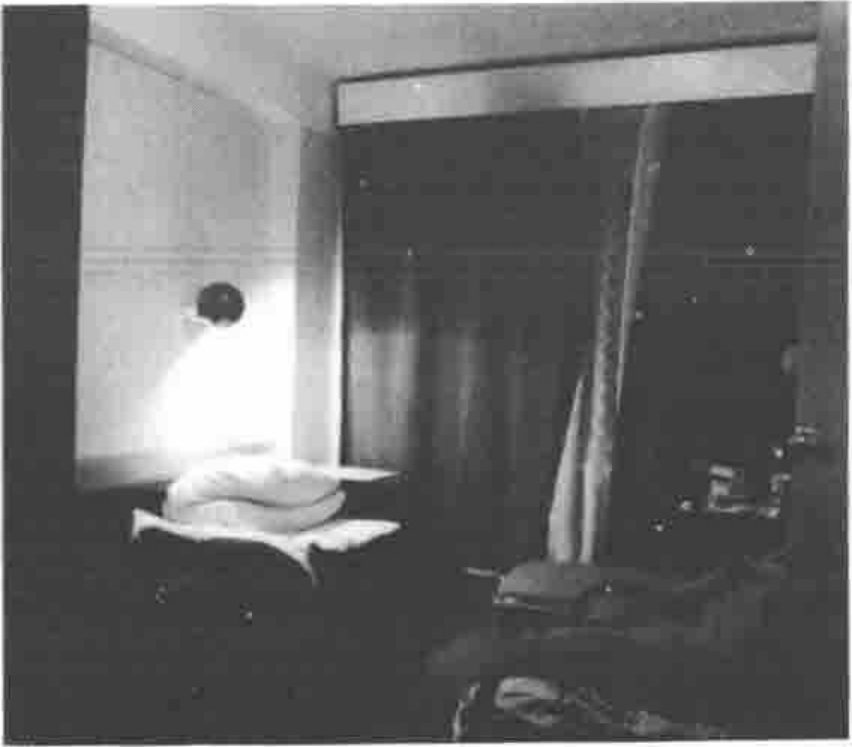
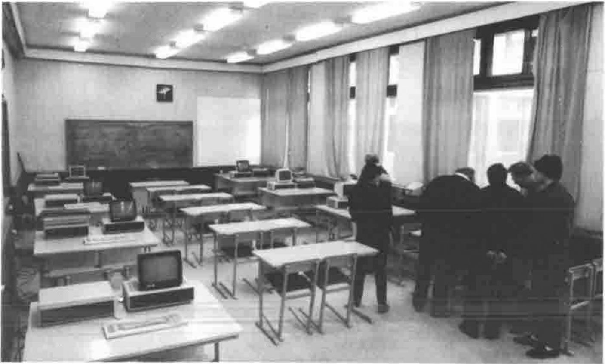
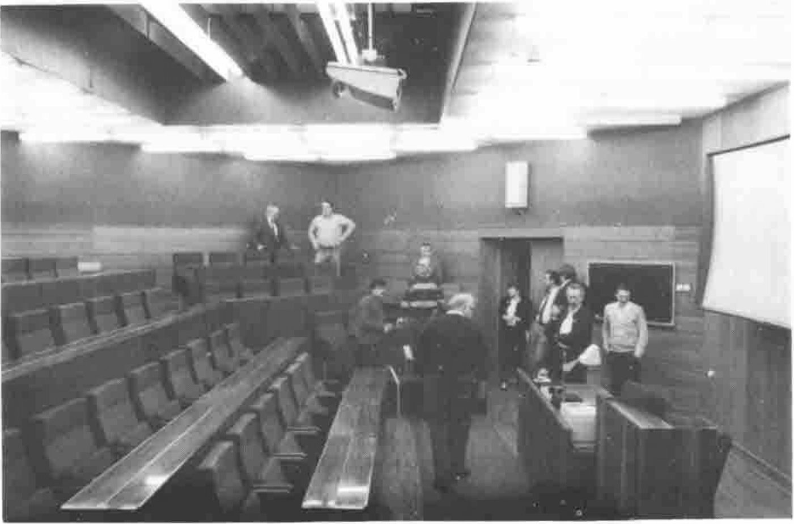

*by Anthony Camacho*
{ .byline }

I attended the meeting of the APL 92 program committee in St Petersburg from 9 to 12 January 1992 as a representative of the British APL Association. I had to be bullied to go as at that time of year the hours of daylight are few and the temperature is low; I don't like the dark and cold. The conference itself will be in July when you can read your watch by natural light at midnight and the weather is warm.

## First Impressions

Nikolai Puntikov met me and drove me to the centre in his car. The airport is the far side of St Petersburg from the centre. Even though it was dark it was plain that St Petersburg is a very beautiful city, with hundreds of eighteenth century buildings and intersected by about seventy canals and rivers; there are about three hundred bridges.

## The Leningrad Education Centre

The Director told us they are in process of reorganising; for 20 years they have worked in industrial training. They don't intend to change direction, but to undertake much more international work, especially in management and marketing. They already have many links with foreign partners and hold many events in conjunction with institutes and companies abroad (there was a flag in his office left by a group from Dallas). There are lots of problems to solve if they are to keep going in this unstable time. They have to earn money independently; there has been no state subsidy for the last two years.

At present the centre is still a State Institute called the Leningrad Education Centre but they may change the name to reflect both St Petersburg and the fact that there is no longer a USSR for them to be a State Institute of. Perhaps it will become an independent international management school; they are seeking partnership with a European Bank. Obviously they are jumping at the chance to cater for an international conference at least partly paid for in hard currency.

The Director expects that by the summer a satellite telephone link to the world network will be working (a firm from Denver is currently installing it). The Centre contains its own medical facilities and staff. The building is 7 minutes from the nearest metro and 15 minutes by car from the centre of St Petersburg.

The Leningrad Education Centre is three buildings on six floors. It contains:

> Rooms for about 300 people,
>
> A restaurant and bar,
>
> One large hall which will seat over 300 in raked seats and which has room for even more seats if needed.
>
> Two smaller halls with TV projectors which will each seat 60 or more, also with raked seating.
>
> One specially large room which will seat 100 or more
>
> About fifteen rooms which could seat 20 to 30 each
>
> A room of 60 square metres which could be the software exchange
>
> A library and the usual associated facilities.
>
> Each room used for presentations will have two OHPs, one with an LCD screen for projecting a computer screen for the audience to read.

## The Accommodation for Delegates

I had a single room with bed, desk, wardrobe, table, desk lamp, silent fridge (absorption) and a television aerial (some rooms had sets - I guess the one from mine was being repaired). There was a private bathroom with shower, WC, washbasin, heated towel rail and a bowl with a washboard for washing clothes. These are the very same rooms that will be used for the conference. The accommodation was much better than at Stanford or Manchester.

*A view of my room*

## Food for the Conference

The food for the conference will be much better than the news would lead one to believe. The real problem is the volatility of the currency. Farms are having to trade by barter to ensure that they don't lose too much when the value of the rouble changes rapidly so it is hard to buy for roubles — i.e. you queue. You can buy anything with foreign (hard) currency. Since the conference expects to entertain many visitors from abroad the organisers have signed contracts for the food with a Russo-Finnish company to be paid for in Finnmarks. This is a contract which is very attractive to the supplying company and provides them with some stability in the Russian world of unstable prices. This company can thus buy any food they want in Russia and anything they can't get there, they can import from Finland. It is about four hours by road from Helsinki.

*The room for the Software Exchange*

## As Tourists, Delegates may be Rich

While I was there the shortage of hard currency was so severe that five U S dollars would buy food for a family of four for a week. This makes the price of souvenirs — indeed more or less everything — very cheap indeed for visitors from any country which uses hard currency. There were touts who were offering bottles of Russian Champagne (very good it is) to tourists on buses at $2 a bottle. It seemed cheap but not when one found out what it could be bought for elsewhere. One can hope that the currency problems are reduced by the time the conference happens; if they aren't life as a tourist will be comparatively luxurious and incredibly cheap.

*A view of the 60-seat lecture theatre*

## Conclusion

APL 92 will be well fed, comfortably accommodated and in a beautiful city. Visitors from abroad are likely to find that the exchange rate is still very favourable. My impression is that the Russian organisers are making a great effort to ensure that the occasion will be a memorable one. I haven't seen the program yet, but of course I have a good idea of some of the papers. Sylvia and I are going. I hope we see you there.
