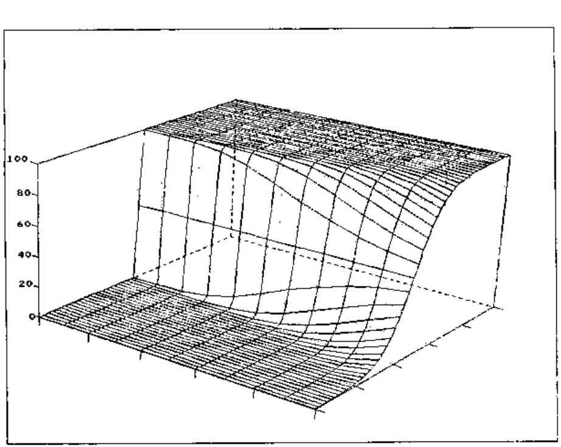

*previewed by Oleg Pöhl*
{ .byline }

Just as the principles of statistical quality control were invented in the West (by Edward Deming and Dr Walter Shewhart in the 1940s) and exploited in the East, so might be the obscure ideas of Fuzzy Logic. The core concepts go back to Poland in the 1920s, with the work of Jan Lukasiewicz, and the theory was developed by Prof. Lotfi Zadeh of the University of California (See Robert Bittlestone's review in Vector [1]). He coined the term "Fuzzy Logic" in his paper in the academic journal "Information and Control" in 1965.

Since that time, fuzzy systems have occasionally turned up in real process control applications, for example running a cement kiln in Copenhagen in 1980, but limitations in available hardware have prevented mass acceptance of the technology. For example, IBM Research developed APL/360 (so called because it *reduced* the power of the System/360) in late 1976, but unfortunately it reduced it so much:

```apl
      ⍳12
1.2 1.9 3.03 3.98 5 5.92 7.12 8.0002 9.21 9.976 11 12.07
```

... that an expression like the above took over 3½ hours to execute on a 370/148. Even IBM realised that this was over-doing it, and APL/360 never made it to the marketplace.

## Understanding Fuzzy Systems

The best way to approach the ideas of fuzzy logic is to find a really fuzzy system, and watch it working for a while. A typical example was explored in Vector by Smith [2], where APL was used to derive the uncertainty function for an automatic checkweigher. This device is supposed to accept all boxes over a certain weight, and reject all boxes that fall below. A perfect device could be drawn as a step-function, with the probability of acceptance jumping from 0% to 100% as the set weight was passed.

Of course in the real world the machine is subject to random influences (vibrations, small variations in the spacing and orientation of the packs etc.) which 'blur out' this sharp edge. You can demonstrate this effect by making up a set of test packs at known weights which straddle the set point, passing them repeatedly over the checkweigher in a random sequence, and recording the pass/fail rate at each weight. What you find looks a bit like this:


The fitted curve was generated using the Logistic function:

```apl
PACKS←219+⍳13   ⍝ Set of test packs at 1gm intervals
UNC←1.31        ⍝ Uncertainty parameter
SET←224.48      ⍝ Best fit to 50% rejection rate

FITREJ←100×÷1+*(PACKWT-SET)÷UNC
```

If you extend the plot to 3 dimensions, the importance of the uncertainty parameter becomes clear:



## A Natural Extension to APL

If we discount those first-generation APLs which implemented fuzz accidentally, we find that some kind of nested array structure is essential for an efficient representation of fuzzy data. For some time, IBM Japan have been working on a series of extensions to APL2/PC which exploit the power of the Togai InfraLogic Fuzzy expansion card. Instead of generating simple vectors, functions such as `⍳` produce nested objects, where each element is a 'fuzzed' set of numbers, obeying the logistic probabilities:

```apl
      ⎕FUZZ←5 0.5     ⍝ each point generates 5 numbers, with U=0.5
      NOS←⍳5
      ⍴NOS
5                     ⍝ Shape is not fuzzy!
      ⍴¨NOS
5 5 5 5 5
      2⊃NOS
1.91 1.96 2 2.04 2.09
```

Things get interesting when you start doing arithmetic with these fuzzy objects ... the system responds by adding levels of nesting, and effectively producing the 'outer product' of the fuzziness:

```apl
      XX←NOS×2      ⍝ note that '2' is also fuzzy
      ⍴XX
5
      ⍴¨XX
5 5 5 5 5
      ⍴2⊃XX
5 5 5 5 5
```

... to stop things getting totally out of hand, the implementors have added a second system variable `⎕FUZZDEPTH` which results in the aggregation of the blurring when the arrays get to this depth. By default, `⎕FUZZDEPTH←5` which is more than adequate for the majority of applications. The APL/360 example at the top of this preview effectively had `⎕FUZZDEPTH←0`, but used a different (randomised) strategy for generating the uncertainty.

## Applications

Already, fuzzy technology is on sale in the UK in the shape of Panasonic's new NV-S1 camcorder; this effectively eliminates 'jitter' by storing images and using earlier images to smooth incoming data.

In the APL world, there are obvious uses in the areas of Sales Forecasting, Dealing-room systems, and so on, in fact anywhere where the system must take decisions based on uncertain information.

In a typical forecasting system, there will be an inherent uncertainty associated with each product group (fleet cars are a more reliable market than luxury limousines), and also an extra uncertainty which increases with time. It is also possible that some markets might have more volatile sales patterns than others. If you add to this the effects of currency fluctuations, you soon realise that `⎕FUZZDEPTH←5` is likely to be about right, and that it is essential that the system handles these rapidly ramifying structures for you. In fact, the implementors are experimenting with a further extension to `⎕FUZZ` to allow a 2-column matrix to represent increasing uncertainty with time:

```apl
      ⎕FUZZ←(4+⍳12), [1.5] 0.5×(⍳12)*.5
      NOS←⍳5
      ⍴NOS
5                     ⍝ Still 5 elements
      ⍴¨NOS
5 6 7 8 9             ⍝ but more detail underneath
```

Note that many functions and system variables (including of course `⎕FUZZ` itself) implicitly localise `⎕FUZZLEVEL←0`!

## Availability

Fuzzy APL will be available exclusively from APL-38(4.5 5 5.5) from 1st April (1994.6 1995 1995.4) (UK and Rockall only)

For more details, contact:

> Hugh Phelfritt (no relation),<br>
> Brook House, Gilling East (or maybe West), York<br>
> Tel: 04393-38(4.9 5 5.1)

## References

1. *Fuzzy Sets and Decision Analysis* by Zimmermann, Zadeh & Gaines, reviewed by Robert Bittlestone. Vector Vol.1 No.4 page 51
2. *Using the Logistic Distribution to Model Fuzzy Decisions*; Adrian Smith, Vector Vol.2 No.2 page 109.
