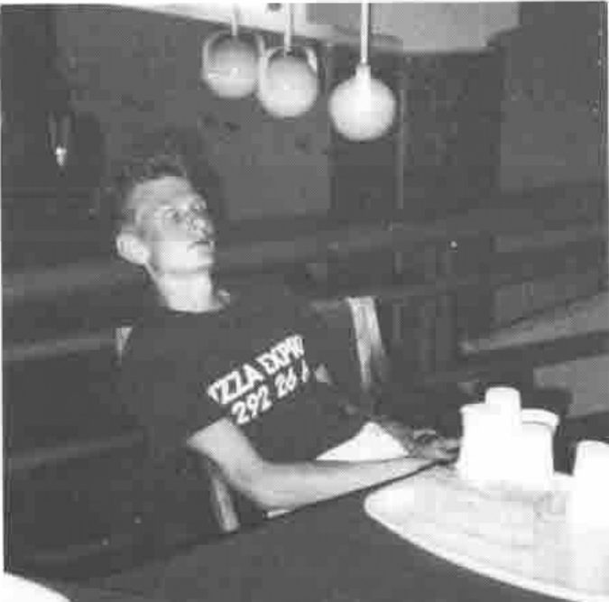
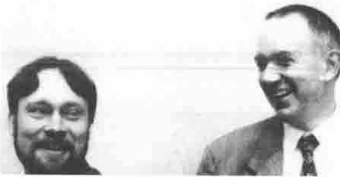
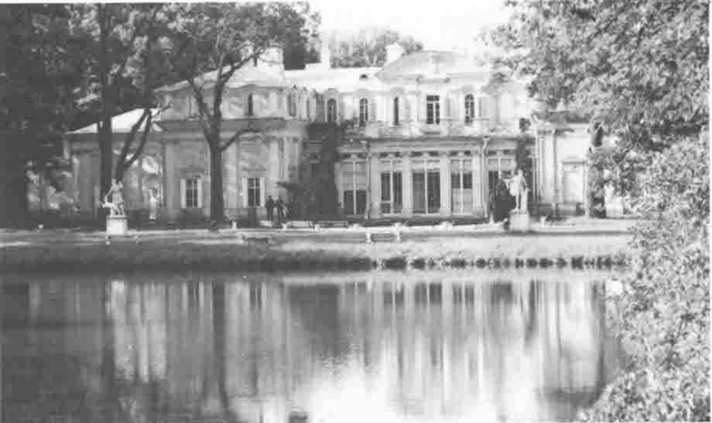
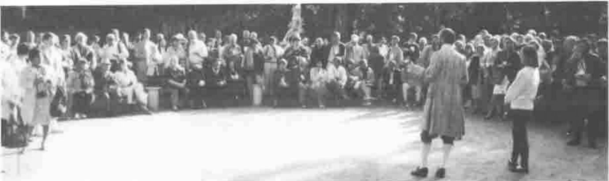

*notes by Ray Cannon*
{ .byline }

Pizza Express Staff worked 20-hour days
{ .caption }

The slogan of Pizza Express (the Finnish firm who provided most of the catering for the conference) is “We deliver in Leningrad”. Well, they almost did not.

As is now usual, Vector was to be given out to the delegates. The problem was, how to get it hot off the press from the printer’s in the UK to the conference site. The solution was to send it to Helsinki by air mail, and then overland (via a Pizza Express lorry) to St Petersburg. Sounds fine in theory but … the Vectors (or BEKTOPs) were put on the P.E. lorry bound for St Pete’s but did not arrive in time to be included in the delegates’ handouts on Sunday. They still had not arrived on Monday. By the end of Tuesday, I was giving up hope of ever seeing them. Finally on Wednesday, someone found them (in Pizza Express’s deep freeze storage?) and they were delivered to the Conference. All’s well that ends well.

IBM had hoped to provide all the delegates with a copy of the IBM Systems Journal which featured APL. Unfortunately, they appeared to have used a more conventional mode of transport. They never arrived.

I am sure there’s a moral in there somewhere.

## Evening Seminars

Summer evenings in St Petersburg are long, and the bar at the conference centre stayed open till about 1:30am. The normal beverage consumed was a Finnish canned beer called “Lapin Kulta”. This was quickly renamed Rabbit Beer. There was also available “APL 92 Vodka” which has the slogan “Cool before discussion” printed on it.

By the time the bar closed, it would be starting to get light again (not that it really got that dark) and it would be time for “Evening Seminar”. This ritual meeting of minds normally occurred in Sasha(Alexander Skomorokov)’s room. Often the participants would be adding the final touches to their paper (to be given the next day at the conference). These meetings lasted till about 3 or 4 am.

I used to wonder why most Russians walk round looking so glum; now I know, it’s just a permanent hangover.

## Modern User Interfaces

James Wheeler and John Scholes
{ .caption }

James Wheeler (Manugistics STSC APL) and John Scholes (Dyadic Dyalog APL) hosted an excellent workshop on APL and Windows. Both vendors were offering a new version of their own product running under MS Windows. Surprisingly, at the workshop there appeared to be no rivalry, also neither product was shown or promoted. (This was reserved for the vendor forums.)

The workshop explained the different approach needed to program systems to run under Windows, and how the vendors had implemented the Windows interface. The whole talk was rounded off with an excellent slide of “A piano designed by Bill Gates”.

**Manugistics APL under Windows.** This product seems to provide a complete interface to MS Windows, by providing low-level access to every Windows procedure, thus allowing full Windows capabilities at the cost of a lot (in APL terms) of coding. As someone who has written Windows programs in C++, this APL Windows environment makes Windows programming a lot simpler and easier to debug.

**DYALOG APL for Windows.** Dyadic’s Windows product is quite different. It is designed as an interface which is GUI-implementation independent. It provides a high-level control and a simple Windows interface. Although (at present) it does not provide access to all types of Windows resources (e.g. icons and bitmaps), it is VERY easy to use. (It took me about 20 minutes to produce a window containing “Bill Gates’ Piano”. Prior to that I had only had a 5 to 10 minute introduction to Dyalog for Windows.)

**APL & WINDOWS.** Dyadic and Manugistics products are very different and satisfy very different requirements. In the future they will both come closer together. In the meantime, some enterprising independent APLer should be able to write a set of high-level windows drivers for them, so that the same APL code can run under both vendors’ products.

## APL92 and the KGB

At APL92 we were very lucky to have as one of the invited speakers a former Colonel in the KGB, Alexander Kalinin. He was correctly introduced as “perhaps the most unusual speaker at our Conference”.

Although his talk was interesting in its own right, as Andrei Kondrashev pointed out, it was more important to the Russian audience merely because it was now possible for such a talk to take place at all.

Alexander Kalinin worked in a special department that was responsible for information security and cryptography. Needless to say, he gave away no “trade secrets”.

## CTalk, an Acceptable Alternative to APL?

Jean-Jacques Girardot’s paper “The CTalk Programming Language: A Strategic Evolution of APL” presented a theme that has been bandied about APL conferences for many years now; that of producing a new language with all the strengths of APL but packaged to look more like C, Algol, PL/1, Pascal etc.

However, what made this admirable paper different, not only was the new language CTalk *proposed*, it had already been implemented, and was available (in several machine formats) at the software exchange. Well done.

(Unfortunately for me, when I got home and tried to decompact my copy of CTalk, I found that I have got the wrong version of the utility PKUNZIP to extract the files. Has anyone else out there got a copy of CTalk (for IBM PC) I could have?)

## The Ultimate Question.

G.A.Langlet “Towards the Ultimate APL-TOE” (TOE=Theory of Everything)

As is well known to fans of The Hitch Hikers Guide to the Galaxy, the Answer to Life, the Universe and Everything, is 42. However, if you attended APL92, you might be forgiven for believing it to be “Difference Scan”. In his excellent paper (and in many of the question and answer sessions following other papers) Gérard postulates that the NotEqual Scan is the ultimate (and possibly only required) algorithm. If you enjoyed reading Douglas Hofstadter’s book “Gödel, Escher, Bach: An Eternal Golden Braid” read Gérard’s paper.

## Water Joke

> Question. What’s the difference between tap water at the Conference centre and its coffee?
>
> Answer. The coffee is hot sweet black water, the tap water is cold bitter black water (and there’s no milk in either of them).

St Petersburg is built on islands, hundreds of islands so water (and bridges) played a large part in the conference visits.

First the cruise to Kronstadt by high speed hydrofoils, to visit Menshikov’s Palace at the Russian Naval base. I took several photos of Russian military hovercraft, and naval vessels. It was a very strange feeling openly walking around a former USSR naval base with a camera in my hand! On the trip back (by bus convoy) we had a police escort complete with flashing blue light. Heaven knows how many red traffic lights we passed.

Then the fireworks over the lake outside the Chinese Palace at Lomonosov, after an evening of Russian Music, Food, Culture, Dancing and Mosquitoes. (Followed by an exciting bus ride, with escort back home.)

The Chinese Palace at Lomonosov
{ .caption }

Not forgetting the pond and fountain in the Hotel Petersburg before the Closing Banquet; the entertainment at the banquet reminded me of Las Vegas. Again the evening was ended by a high-speed dash though the streets of St Petersburg.

Poetry at the Chinese Palace
{ .caption }

However my lasting memories of St Petersburg will not be the conference, the architecture, the bridges, the food, or the trips, but the stalls which surround the Metro stations like small shanty towns, selling almost anything from books to beer, and toothpaste to Vodka, but never windscreen wiper blades.
