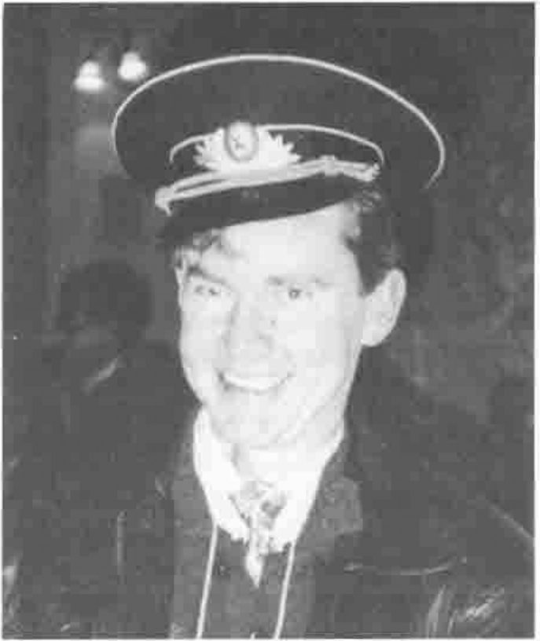
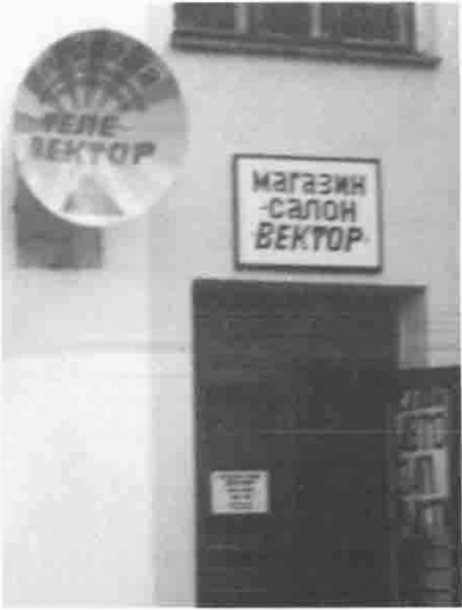

*by John Searle*
{ .byline }

*John Searle*
{ .caption }

1. An ASCII keycap set is available for APLers who want to learn J — Bob Brown
2. I wanted to divide this pie chart into 7 categories, but my drawing package couldn’t do that, so I have 8 categories. I’ll tell you later which one I didn’t want — Martin Gfeller
3. It’s difficult to understand that APL is so easy — a Russian student at the young APL world classroom
4. I have one more slide, and then I’ll ask questions — Bob Bernecky
5. Speed is not important until you’ve seen something go faster — Walter Spunde
6. In no other language could one afford the luxury of implementing so poor an algorithm to demonstrate the idea so clearly — Walter Spunde
7. If APL is so bad, why are so many people using it? — Cory Skutt
8. Please do not judge me by my lecture; I have many other good qualities — Elod Polgar
9. A good composer does not imitate, he steals — Igor Stravinsky quoted by Elod Polgar

*The BEKTOP Shop!*
{ .caption }
