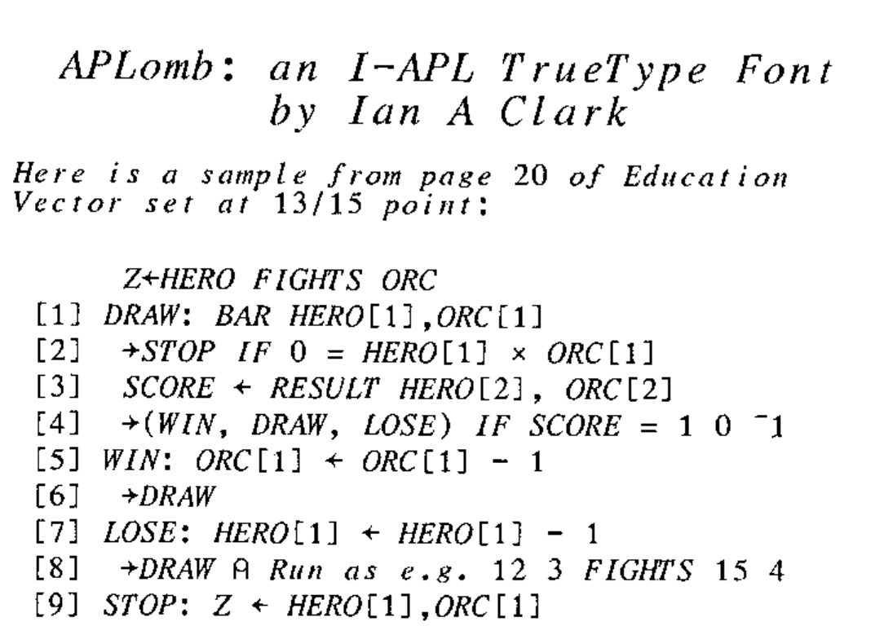

## Cash Available — No interest! You don’t even have to pay it back!

*by George MacLeod*
{ .byline }

### An Offer you Cannot Refuse?

The British APL Association has funds available to give as grants to members of the Association to fund or partly fund projects that fit in with the BAA constitution.

The constitution says that the objects of the Association are:

1. To promote the use of APL.
2. To develop awareness and competence in APL.
3. To represent the interests of Association members with other bodies.
4. To contribute to the development of the language and definition of international standards.

### Recent Projects

The major recent project, which is still on-going, is the APL Statistical Library where the BAA funding included paying a programmer and paying the costs of the annual conferences.

A recent small project was the printing of the I-APL manual in Cyrillic.

Another project currently under way is being carried out by Dr Ian Clark which involves the porting of I-APL to System 7 operating system on the Macintosh. This will form the heart of Ian’s development of a tool to assist in the production of educational monographs which will be accompanied by I-APL workspaces which will demonstrate the principles being taught. Ian’s I-APL TrueType font is freely available via I-APL Ltd (see Product Guide); a small sample is illustrated overleaf. Most of the funding for this project has come from other sources but that funding was contingent on some funding by the BAA as a mark of its approval.



*APLomb: an I-APL TrueType Font, by Ian A Clark*

*Here is a sample from page 20 of Education Vector set at 13/15 point:*

```apl
      Z←HERO FIGHTS ORC
[1] DRAW: BAR HERO[1],ORC[1]
[2]  →STOP IF 0 = HERO[1] × ORC[1]
[3]  SCORE ← RESULT HERO[2], ORC[2]
[4]  →(WIN, DRAW, LOSE) IF SCORE = 1 0 ¯1
[5] WIN: ORC[1] ← ORC[1] - 1
[6]  →DRAW
[7] LOSE: HERO[1] ← HERO[1] - 1
[8]  →DRAW ⍝ Run as e.g. 12 3 FIGHTS 15 4
[9] STOP: Z ← HERO[1],ORC[1]
```

### How Do I Get Some Money?

Contact George MacLeod, the BAA Projects Officer, at the address at the back of Vector and tell him what you have in mind. If it seems like the project is within the rules then a description of the project needs to be produced. The Projects Officer can assist with this. Once this is done the Projects Officer presents the description to the BAA Committee at its next meeting and usually approval is forthcoming.

### Where’s the Catch?

There really is not a catch. A condition of the grant will be a description of the project for Vector and if it is appropriate a presentation at one of the BAA meetings. Sometimes it is possible to put part of the project in the public domain for the wider use of the APL community. Part of Ian Clark’s project was the production of a TrueType I-APL font which is now freely available for people who need an I-APL font for producing documents under Windows 3.1 and elsewhere.

### Will this help me to my First Million?

It might, but the grants are not really intended to fund commercial ventures. However, it is possible that the BAA may act as lender of last resort, if the project is believed to be worth while, but other sources of funds are not available. Also the funds available are not enormous. A grant or a loan would be measured in hundreds or thousands of pounds, rather than tens of thousands.
