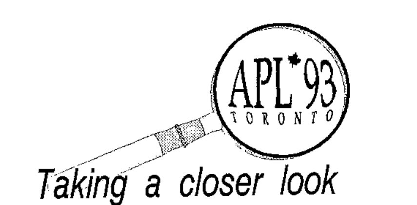

## Welcome: Conference Chair

In the Spring of 1973, a conference called APL5 was held in Toronto at the Inn on the Park. The banquet was held at the Ontario Science Centre, and the guest speaker was Dr. Kenneth Iverson, the inventor of APL. Twenty years later, Toronto will again host an international APL conference. This time it will be held in the Medical Sciences Building of the University of Toronto, which is near the centre of the city.

I am delighted that Professor Leroy J. Dickey has volunteered to be the Program Chairman for the conference; he has provided a rich and varied formal program. Further, Bob Bernecky has volunteered to take responsibility for all the other program events which do not involve the formal delivery of papers. These include tutorials, workshops, panels, poster sessions, birds-of-a-feather sessions and an APL Art Gallery, all to round out and enrich the program. There will also be an exhibitor’s area which we expect will be well supported by vendors.

Toronto in August is a delightful place to be. It is a safe, walk-about city, with literally hundreds of activities within a short walk of the conference site, including sightseeing, shopping, dining and theater. Delegates are encouraged to bring their families, and a variety of activities will be available for accompanying persons. Toronto is easy to reach, having an international airport with direct flights from many European, American and Canadian cities. It is also within a day’s drive of Boston, New York, Washington, Pittsburgh, Cincinnati and Chicago.

I look forward to greeting you at the APL93 Conference in Toronto.

*Larry Moore, Conference Chair*

## Program Chair

Hello. I am pleased to report to you that the papers for this year’s conference are among the best that I have seen for any APL meeting in the last ten years. I find the range of topics particularly exciting, as I am sure you will too, when you browse through the attached list. I am impressed at the wide variety of applications to which APL has been put both in research and in production, in science, industry, business and academia. Not only are the applications of APL being developed, but the foundations of APL are being explored as well. There are new areas of research, and new linguistic features. Are these things just a flash in the pan, or are they elements that will join the mainstream of computing and be taken for granted in years to come? We leave that question for time to resolve, but we invite you to be a part of the fomentation and excitement now.

Come, attend the invited talks, attend the contributed papers, participate in a tutorial, participate in a workshop, bring a poster, bring some shareware, participate in a Birds of a Feather session, and have a good time. A friend of mine says that the best part of a conference is the people that one meets in the halls, outside of sessions. For me too, a high point of APL meetings, is the people that I meet.

Come to APL93, and let us meet and share ideas about APL.

*Leroy J Dickey, Program Chair*

## Tutorials Chair

Welcome to Toronto! APL93 represents a dramatic improvement over previous conferences — we have encouraged a varied and plentiful selection of tutorials, fully integrated with the remainder of the technical program, to enhance your educational opportunities while in Toronto. We have rethought a number of other conference activities, including posters sessions, the APL art gallery, the APL software exchange, Birds-of-a-Feather sessions, with an eye toward enriching your experience here, by changing their focus to be of greater benefit to attendees and to perform outreach to the community beyond that of the APL community.

Do you feel that tutorials at APL conferences are somehow peripheral to the main program? Have you ever been frustrated by short presentations of research papers, in which time constraints prevent The Really Interesting Questions from being answered. Do you want to have the time to actually learn how some of these new gadgets work?

APL93 has turned that whole idea on its head, by making tutorials a well-integrated part of the conference, open to all attendees. Yes, there is the ever-present hazard of coming away from APL93 knowing more than you did when you arrived, but I know you’ll get accustomed to it and enjoy it!

The tutorial program for APL93 offers a wider selection of topics than any previous APL conference, and registration for two half-day tutorials is included with your pre-registration fee. We are making attendance at tutorials possible at very low cost, because we want to make education an integral part of the conference program.

*Robert Bernecky, Tutorials Chair*

## Tutorials

Many tutorials this year will be hands-on, with each attendee sitting at her or his own PC or SUN workstation, provided by the University of Toronto Department of Computer Science. Subjects (and speakers) will be:

- Teaching Calculus — Kenneth E. Iverson
- An Introduction to J — Donald McIntyre
- Image Processing in APL — Manuela Schäfer, Dinu Scheppelmann
- APL for Actuaries — Richard L. Vaughan
- 3D-Visualization of Medical Images in APL — Pitt Meinzer
- AGSS: A Graphical Statistical System — Peter A.W. Lewis
- An Introduction to Parallel Computing — Robert Bernecky
- Mathematica for APLers — Richard J. Gaylord
- An Introduction to APL — Ben Best
- Windows GUI Programming in APL — Eric Iverson
- Wicked Problems and APL — Chris Lee

Please be advised that registration at specific tutorials will be opened to non-registrants on a space-available basis on the day of the tutorial. I believe that such outreach is an important activity, particularly when APL has a vital role to play in the emerging area of massively parallel computing.

Therefore, to avoid disappointment because of Standing Room Only crowds, please be sure to register for your tutorials at the time of pre-registration. Otherwise, you may be left out, due to lack of space. In particular, hands-on tutorial space is limited by machine availability. Pre-registration will let us find appropriate venues for the tutorials so that you won’t be left out or sitting on the stairs.

The registration form allows you to specify alternate choices for each tutorial timeslot, in case the tutorial you prefer is fully booked. Also, you’ll save money, because early pre-registration offers you two free tutorials, whereas you only get one if you register late.

Most of the tutorials will be offered on Sunday, August 15th and again during the conference, for the convenience of conference delegates. I am very grateful to those presenters who have volunteered to take on this extra workload!

*Robert Bernecky, Chair of Tutorials*

## Invited Speakers

### Opening Plenary:

#### The Triumph of Symbols over Words

*Professor Donald McIntyre*

Professor Donald McIntyre illustrates highlights in 5,000 years of evolving notation. Ideas, once expressed in rhetorical form, are increasingly represented by symbols. Early forms of symbolism were often subsequently modified or replaced. The new symbolism of Iverson and Hui’s J language provides a reason for reflecting on this history

Donald McIntyre is a retired Professor of Geology who has been using computers and teaching computer programming for over 30 years. He has been an invited speaker at many APL Conferences, and was a Distinguished Lecturer for ACM from 1985-1990. He has given workshops on J in London and in many cities in the United States and Canada. He contributed one of two papers on J included in the IBM System Journal’s special issue marking the 25th Anniversary of APL. His 70th birthday will coincide with his Sunday presentation of this tutorial.

### Closing Plenary:

#### Modelling Petroleum Chemistry in the Era of Clean Fuels

*Dr. Stephen B. Jaffe*

Today’s environmental issues require the Oil Industry to make a product of specific chemical composition and specific physical properties. To meet these new targets, petroleum refiners and planners must turn to mathematical models for guidance. The challenge for these models is to follow the chemistry of thousands of molecular species through hundreds of thousands of chemical reactions. A new approach called Structure Oriented Lumping (SOL) has been developed which represents petroleum molecules as collections of structural increments. Models using SOL are capable of predicting far more detail than ever before.

APL plays a crucial role in every aspect of Structure Oriented Lumping. Experimental data is organized, reduced, and analyzed with APL. Reaction networks are generated using a rule-based approach for specifying the appropriate chemistry with APL. Finally, FORTRAN code is automatically generated by APL to integrate the pertinent differential equations. This novel solution of a major problem is a direct consequence of our long-time familiarity and use of APL.

Stephen B. Jaffe has been an active APLer for more than twenty years. He has authored many papers on APL, served on the ACM SIGAPL Board, has organized APL conferences, and taught APL. Dr. Jaffe is a Senior Research Consultant at Mobil Research and Development in Paulsboro, New Jersey.

